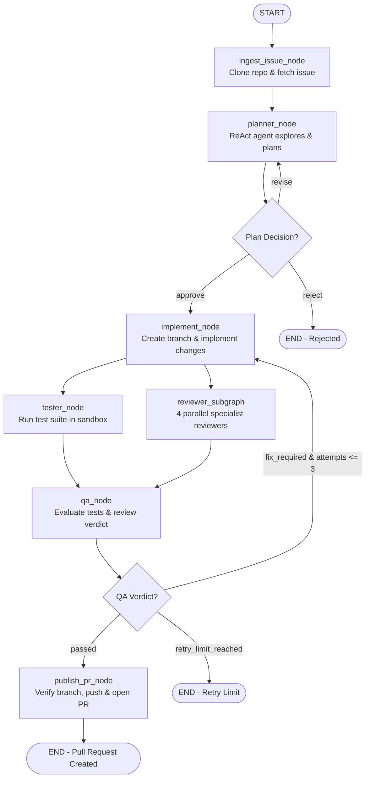

# DevPilot Architecture & Codebase Map

DevPilot turns GitHub issues into tested, reviewed, and human-approved Pull Requests using LangGraph, isolated E2B cloud sandboxes, and tiered LLM agents.

## Directory Structure

```text
backend/src/devpilot/
├── core/
│   ├── config.py            # Environment settings and API keys
│   └── logging.py           # Structured logging with secret redaction
├── models.py                # Shared data models (GitHubIssue, WorkspaceInfo, TestResult)
├── llm.py                   # Role-tiered OpenAI client (gpt-4o vs. gpt-4o-mini)
├── github.py                # Remote GitHub MCP client and token minting
├── sandbox.py               # E2B sandbox wrapper and git operations (clone, branch, push)
├── workflow.py              # DevPilotState clipboard and decision choices
├── tools/
│   ├── search.py            # Codebase navigation: find_files (glob) & search_code (grep)
│   ├── files.py             # Clean file I/O: read_file, write_file, replace_in_file
│   ├── git.py               # PR inspection: git_diff
│   ├── shell.py             # Execution: bash_tool & bounded run_tests_tool
│   └── delegate.py          # Orchestration: delegate_work with 5-worker concurrency & scope bounds
└── agents/
    ├── planner/agent.py     # ImplementationPlan, PROMPT, plan_node
    ├── implementer/agent.py # ImplementationReport, PROMPT, implement_node
    └── reviewer/agent.py    # Finding, ReviewResult, ReviewState, prompts, review subgraph
```

---

## Agent Tool Matrix (Agent-Computer Interface)

| Tool | Planner | Implementer | Worker Subagents | Reviewers |
| :--- | :---: | :---: | :---: | :---: |
| `find_files(pattern, path)` | ✅ | ✅ | ✅ (scoped) | ✅ |
| `search_code(query, path)` | ✅ | ✅ | ✅ (scoped) | ✅ |
| `read_file(path, offset, limit)` | ✅ | ✅ | ✅ | ✅ |
| `write_file(path, content)` | ❌ | ✅ | ✅ (scoped) | ❌ |
| `replace_in_file(path, old, new)` | ❌ | ✅ | ✅ (scoped) | ❌ |
| `bash(command)` | ❌ | ✅ (tests/linters) | ❌ | ❌ |
| `run_tests(command)` | ❌ | ❌ | ✅ (test runner only) | ❌ |
| `git_diff(base_branch)` | ❌ | ❌ | ❌ | ✅ |
| `delegate_work(task, files)` | ❌ | ✅ | ❌ | ❌ |

---

## Agent Anatomy (How Each Agent File is Structured)

Every agent lives in a single, self-contained `agent.py` file with the exact same reading order:

1. **Types**: Pydantic response models specific to this agent.
2. **Prompt**: The system prompt constant instructing the LLM.
3. **State**: TypedDict representation of what the agent needs.
4. **Node(s)**: The async function that LangGraph invokes.
5. **Graph / Merge**: Compiles the graph or merges results if multi-step.

---

## How to Add a New Agent in 5 Steps

When creating a new agent (e.g. for QA or Documentation):

1. **Create directory**: `mkdir backend/src/devpilot/agents/my_agent`.
2. **Create `agent.py`**:
   - Section 1: Define output model `class MyAgentOutput(BaseModel): ...`.
   - Section 2: Define system prompt `PROMPT = "..."`.
   - Section 3: Define node function `async def my_agent_node(state, config): ...`.
3. **Select tools**: Pass permitted tools (e.g. `search_tools(sandbox)`, `read_only_file_tools(sandbox)`).
4. **Create `__init__.py`**: Re-export the node and models.
5. **Connect in `workflow.py`**: Add the node and transition edges to the graph.

---

## End-to-End Workflow Flow (`devpilot/workflow.py`)


